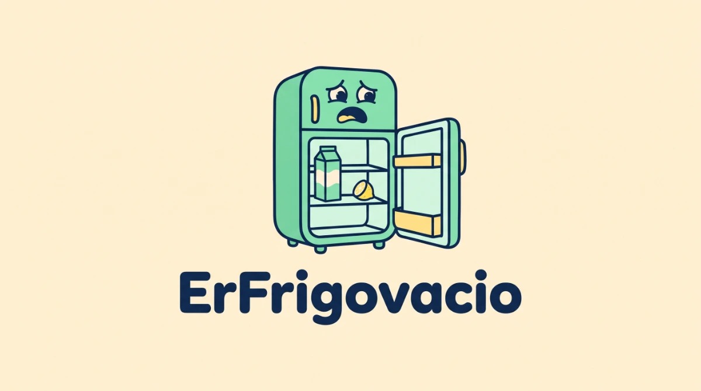

# ErFrigovacio

<p align="center">
  
</p>

Lista de la compra colaborativa para una casa. Sin cuentas, sin contraseñas y sin fricción.

- Entras y creas tu lista en segundos. No hay registro ni PIN: la app te asigna una **identidad anónima** y recuerda tu sesión en el dispositivo.
- Comparte el **enlace de invitación** por WhatsApp. Quien lo abra entra directamente en la lista y puede añadir productos al momento.
- La lista está siempre abierta: añadir, marcar y borrar es inmediato. Se sincroniza cada pocos segundos entre todos los dispositivos.
- Al pulsar **Finalizar compra**, todos los productos se marcan como comprados y la lista queda vacía para la siguiente compra.
- La sección **Más usados** agrupa productos parecidos (plurales, tildes, erratas de una letra, “de/la”…) y cada uno se puede añadir a la lista con un toque.
- El creador del hogar puede **renombrarlo** y **expulsar** a otros miembros.
- Instalable como PWA en el móvil. Funciona en vertical, con botones grandes y sin menús escondidos.

## Stack

| Capa | Tecnología |
| --- | --- |
| Web | React 19 + Vite + TypeScript + Tailwind CSS 4 + TanStack Query |
| API | NestJS 11 + Fastify + Zod |
| Datos | PostgreSQL 17 + Drizzle ORM |
| Contratos | Paquete compartido `@emptyfridge/contracts` con esquemas Zod y tipos |
| Infra | Docker multi-stage + Docker Compose + nginx (y Caddy opcional para HTTPS) |
| Calidad | TypeScript estricto, Biome, Vitest, GitHub Actions |

## ¿Hace falta Supabase?

**No.** Supabase es Postgres + Auth + Realtime + Storage. Para esta app solo se usaría Postgres y algo de sincronización, así que añade dependencia y complejidad sin resolver nada que no se resuelva aquí:

- **Datos**: PostgreSQL normal en un contenedor. Si algún día se quiere Supabase, sigue siendo Postgres: se cambia la cadena de conexión y los repositorios no se tocan.
- **Auth**: sesiones anónimas con cookies `httpOnly` y tokens hasheados en base de datos. Sin emails, sin contraseñas y sin proveedor externo.
- **Tiempo real**: sondeo cada 3 segundos con actualizaciones optimistas. Para una familia es instantáneo en la práctica y no necesita WebSockets ni Redis.
- **Storage**: no se necesita.

Supabase tendría sentido si se quisiera un servicio gestionado sin administrar backups, o si se necesitaran OAuth/social, almacenamiento de ficheros o edge functions. No es el caso.

La decisión está documentada en [docs/adr/0001-postgres-y-auth-propia.md](docs/adr/0001-postgres-y-auth-propia.md).

## Arrancar con Docker

Requisitos: Docker + Docker Compose.

```bash
cp .env.example .env
# Edita .env y cambia al menos POSTGRES_PASSWORD.
docker compose up --build -d
```

Abre [http://localhost:8080](http://localhost:8080).

El stack arranca en este orden: `db` → `migrate` (aplica migraciones y termina) → `api` → `web`. Sin pasos manuales.

> Sin `.env`, Compose usa valores por defecto pensados para local. No los uses en producción.

Primer uso:

1. **Crear lista** con un nombre. No hay cuenta ni PIN.
2. En **Hogar → Invitar a la familia**, comparte el enlace por **WhatsApp**.
3. Quien abre el enlace entra directamente en la lista con una identidad anónima, sin registrarse.
4. Añade productos, márcalos al comprarlos y pulsa **Finalizar compra**. Si queda alguno sin marcar, se marcará también como comprado.
5. En **Más usados** están los productos que más repetís, agrupados aunque los escribáis distinto, con un botón para añadirlos a la lista actual.

### Comandos útiles

```bash
docker compose logs -f api      # logs de la API
docker compose logs -f web      # logs de nginx
docker compose down            # parar
docker compose down -v         # parar y borrar la base de datos
```

## Desarrollo local

Requisitos: Node 22+ (probado con 24), pnpm 9 y Docker.

```bash
corepack enable
pnpm install

cp .env.example .env
docker compose up -d db

pnpm db:migrate
pnpm dev
```

- Web: [http://localhost:5173](http://localhost:5173)
- API: [http://localhost:3000/api](http://localhost:3000/api)

`pnpm dev` compila los contratos y levanta en paralelo la API (`nest start --watch`) y Vite. Vite hace proxy de `/api` hacia la API, así que las cookies funcionan igual que en producción.

Si `corepack enable` no tiene permisos en tu máquina, instala pnpm con `npm i -g pnpm@9.15.9`.

> Si reutilizas un `.env` de producción en local, pon `PUBLIC_URL=http://localhost:8080`. Si empieza por `https://`, la cookie se marca `Secure` y el navegador no la guardará en `http://localhost`.

## Comandos

| Comando | Qué hace |
| --- | --- |
| `pnpm dev` | Contratos + API + web en modo desarrollo |
| `pnpm build` | Build de producción de los tres paquetes |
| `pnpm typecheck` | TypeScript estricto en todos los paquetes |
| `pnpm test` | Tests unitarios (Vitest) |
| `pnpm e2e` | E2E con Playwright (requiere el stack levantado) |
| `pnpm e2e:install` | Descarga Chromium para Playwright |
| `pnpm lint` | Biome: formato, imports y lint |
| `pnpm format` | Formatea todo el repo |
| `pnpm check` | lint + typecheck + test + build |
| `pnpm db:generate` | Genera una migración de Drizzle a partir del esquema |
| `pnpm db:migrate` | Aplica migraciones contra `DATABASE_URL` |

E2E con el stack levantado:

```bash
pnpm e2e:install   # una vez: descarga Chromium
docker compose up -d --build
pnpm e2e
```

## Estructura

```text
emptyfridge/
├─ apps/
│  ├─ api/                  # NestJS: auth y listas
│  │  ├─ src/modules/
│  │  │  ├─ auth/           # identidades anónimas, hogares, membresías, sesiones
│  │  │  └─ lists/          # listas, productos, más usados
│  │  ├─ src/shared/        # db, config, errores, health
│  │  └─ drizzle/           # migraciones SQL versionadas
│  └─ web/                  # React + Vite + Tailwind
│     └─ src/features/      # auth, list, history, household
├─ packages/
│  └─ contracts/            # Zod + tipos compartidos API/Web
├─ e2e/                       # Playwright: flujo completo en navegador
├─ docker/                    # entrypoint (migraciones opcionales al arrancar)
├─ infra/                     # Caddyfile, backup
├─ docs/                      # arquitectura, despliegue y ADRs
├─ docker-compose.yml
├─ render.yaml                # blueprint de Render
├─ vercel.json                # SPA + proxy /api en Vercel
└─ .github/workflows/ci.yml
```

Cada módulo del backend respeta la regla de dependencia:

```text
interface → application → domain ← infrastructure
```

- `domain`: entidades, reglas puras y puertos. No importa Nest, Drizzle ni HTTP.
- `application`: casos de uso. Orquesta el dominio y los puertos.
- `infrastructure`: adaptadores Drizzle.
- `interface`: controladores, guards, pipes y mappers HTTP.

No hay interfaces “por si acaso”: solo en las costuras reales (repositorio, reloj, generador de IDs, hasher, tokens). El resto es código directo y legible.

Más detalle en [docs/ARCHITECTURE.md](docs/ARCHITECTURE.md).

Mapa operativo para agentes de IA: [AGENTS.md](AGENTS.md).

## Calidad

- **TypeScript estricto** (`strict`, `noUncheckedIndexedAccess`, `noImplicitOverride`).
- **Contratos compartidos** con Zod: la API valida en runtime y la web reutiliza los tipos. Un cambio de contrato rompe la compilación, no la app en producción.
- **Errores homogéneos** con `application/problem+json` (RFC 9457) y códigos estables.
- **Restricciones en la base de datos**, no solo en la aplicación: una sola lista abierta por hogar, un solo producto pendiente por nombre y lista, nombres visibles únicos, un hogar por identidad (`unique user_id`), checks de rol/estado/unidad/cantidad y claves foráneas con `cascade`/`set null`.
- **Aislamiento por hogar** en todas las consultas. Los tests manuales de aislamiento cruzado devuelven `404`.
- **Tests unitarios** de dominio y casos de uso (alta, finalización, hogar, renombrar y expulsar).
- **E2E reales** con Playwright: crear lista sin registro, añadir productos, marcar, finalizar, más usados con agrupación, invitar por enlace, identidad anónima y sincronización.
- **Docker multi-stage**: la imagen de la API solo lleva dependencias de producción y corre como usuario `node`.
- **CI** con lint, typecheck, tests, build y E2E contra el stack Docker completo (incluye health a través de nginx).

## Producción

Hay dos caminos. El detalle completo está en [docs/DEPLOYMENT.md](docs/DEPLOYMENT.md).

### VPS con Docker Compose (recomendado)

1. Configura el dominio y secretos en `.env`:

   ```dotenv
   DOMAIN=lista.midominio.com
   PUBLIC_URL=https://lista.midominio.com
   APP_PORT=127.0.0.1:8080
   # URL-safe: openssl rand -hex 24
   POSTGRES_PASSWORD=<aleatoria-url-safe>
   ```

2. Levanta el stack con el perfil de Caddy (HTTPS automático con Let's Encrypt):

   ```bash
   docker compose --profile proxy up -d --build
   ```

3. Abre `https://lista.midominio.com`, crea la lista y comparte el enlace.

Notas:

- Caddy necesita los puertos 80 y 443 libres y el DNS del dominio apuntando al servidor.
- `APP_PORT=127.0.0.1:8080` deja nginx accesible solo desde el propio host; Caddy habla con él por la red interna.
- Si `PUBLIC_URL` empieza por `https://`, las cookies se marcan `Secure` automáticamente.
- Las migraciones se aplican solas al arrancar (`migrate`).

### Vercel + Render + Supabase (gestionado)

También está preparado en el repo con `vercel.json` y `render.yaml`. Supabase se usa **solo como PostgreSQL**; la auth sigue siendo la propia.

- **Vercel**: publica la SPA y hace rewrite de `/api/*` hacia Render. El navegador ve un solo origen, así que las cookies siguen siendo first-party y no hace falta CORS.
- **Render**: ejecuta la misma imagen Docker de la API. Con plan de pago usa `preDeployCommand` para migrar; con el gratuito, `RUN_MIGRATIONS=true` y una sola instancia.
- **Supabase**: usa el **Session Pooler** (IPv4) con `DATABASE_SSL=require`. Si usas el Transaction Pooler (6543), pon `DATABASE_PREPARE=false`.

Guía paso a paso: [docs/DEPLOYMENT.md](docs/DEPLOYMENT.md).

**Mi opinión**: para una familia, un VPS pequeño con este `docker compose` es más simple y barato que tres servicios; Render free duerme y Supabase free puede pausar. Si quieres cero administración, Vercel + Render starter + Supabase es una combinación perfectamente razonable; Supabase no sobra como Postgres gestionado, pero **no lo necesitas para auth, realtime ni storage**.

### Backups

Si usas Supabase, revisa sus backups automáticos (según plan). En el VPS:

```bash
sh infra/backup.sh
```

Genera `backups/emptyfridge-<fecha>.sql.gz` y conserva 30 días. Para programarlo, añade una línea al cron del host:

```cron
15 3 * * * cd /ruta/a/emptyfridge && sh infra/backup.sh >> backups/backup.log 2>&1
```

Restaurar:

```bash
gunzip -c backups/emptyfridge-2026-01-15-031500.sql.gz \
  | docker compose exec -T db psql -U emptyfridge -d emptyfridge
```

Un backup que no se ha probado a restaurar no es un backup. Haz una prueba de restauración de vez en cuando.

## Seguridad

- **Sin cuentas ni contraseñas.** Cada dispositivo recibe una identidad anónima al crear una lista o abrir un enlace de invitación.
- Sesiones con token aleatorio de 32 bytes; en la base de datos solo se guarda su SHA-256.
- Cookie `httpOnly`, `SameSite=Lax` y `Secure` con HTTPS. Duración por defecto: 180 días.
- Rate limit en creación de listas, unirse a un hogar y operaciones de gestión (20 intentos / 5 minutos por IP y ruta). La IP solo se usa para limitar abuso, nunca como identidad.
- El código de invitación es de 6 caracteres (sin `0/O/1/I`). Los códigos antiguos de 8 siguen funcionando.
- Solo el creador puede renombrar el hogar o expulsar a otro miembro. Al expulsar, se quita la membresía; si la persona vuelve a abrir el enlace, puede entrar de nuevo.
- Todas las consultas de listas y productos filtran por `household_id`. Un miembro de otro hogar recibe `404`, no `403` (no se filtra si el recurso existe).
- En Supabase/Render, la base de datos va con TLS (`DATABASE_SSL=require`) y el pooler correcto.
- Postgres no se publica fuera de `127.0.0.1`.
- No se guardan emails ni datos personales más allá del nombre visible generado.

## Siguientes pasos

- Tests de integración de repositorios con Testcontainers (los E2E ya cubren el flujo completo).
- Soporte para una identidad en **varios hogares** con selector de hogar (hoy hay un `unique user_id` en `household_members`).
- SSE o Web Push para avisar de “se ha añadido leche” sin esperar al sondeo.
- Modo offline con cola de mutaciones (hoy la PWA cachea el shell, pero las escrituras necesitan red).
- Poder cambiar el nombre anónimo desde Hogar.

## Licencia

Ver [LICENSE](LICENSE).
